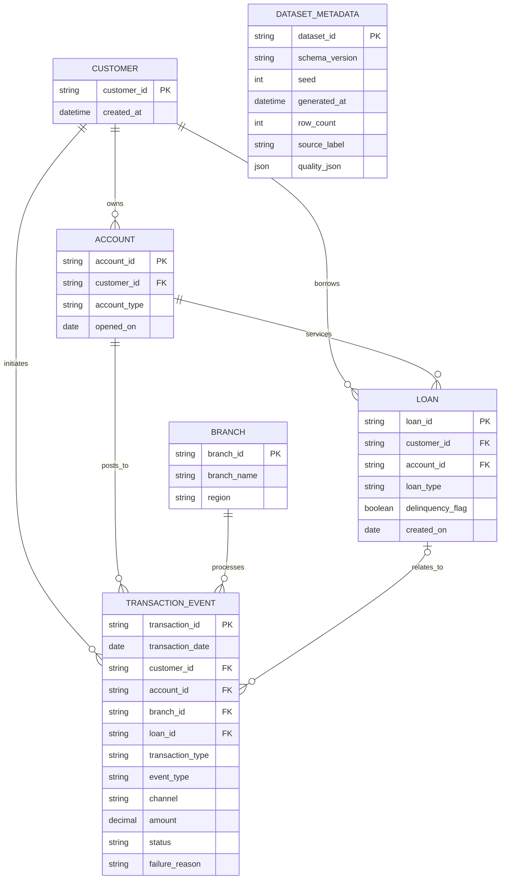

# STEP 9 - ENTITY RELATIONSHIP DIAGRAM
## D17 | Loan Disbursement Trend Analysis

**Version:** 1.0 | **Source:** Step 8 database design

## ER model

## Relationship interpretation

Each transaction event has exactly one customer, account and branch; a loan reference is optional for non-loan activity. One loan may have multiple events: disbursement, repayment, or reversal. Dimension identifiers are synthetic. Dataset metadata describes a generated/loaded dataset and is not part of the customer/loan relationship graph.

## Cardinality and integrity rules

- Customer (1) to Account (0..many); Account (1) to Customer (exactly 1).
- Customer (1) to Loan (0..many); Loan (1) to Customer (exactly 1).
- Account (1) to Loan (0..many); Loan (1) to servicing Account (exactly 1).
- Branch (1) to TransactionEvent (0..many); each TransactionEvent has one processing Branch.
- Loan (1) to TransactionEvent (0..many); TransactionEvent has zero or one Loan.
- Customer and Account also relate directly to TransactionEvent to support non-loan events and to retain event-time attribution. Validate that loan/customer/account identities agree.

## Key and normalization notes

Primary keys are stable synthetic IDs. Foreign keys are enabled in SQLite. Loan type and delinquency attributes live on LOAN, not repeated on every transaction row. If historical loan type or risk status changes become relevant, introduce effective-dated dimensions in a later version. Transaction facts preserve event grain and status; do not collapse repayment/reversal records into disbursement totals.

## Assumptions / limitations

The diagram assumes one customer owns an account and one loan is serviced by one account in the synthetic model. Joint accounts, co-borrowers, refinancing, multi-currency, reversals that net against original events, and time-varying branch ownership are out of MVP scope. Delinquency flag is an illustrative loan attribute without days-past-due history.
